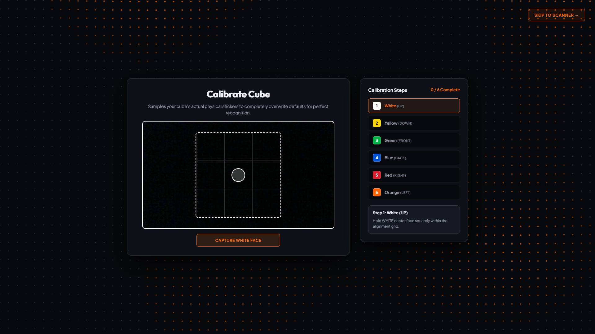
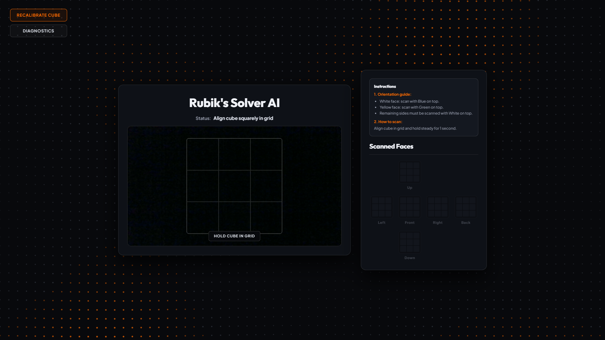
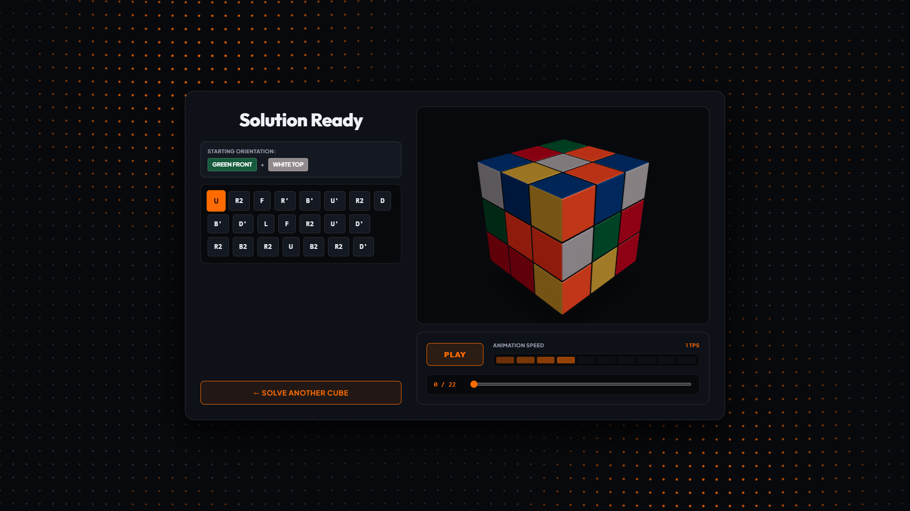

# Rubik's Cube Solver AI 🧊🤖

An intelligent, full-stack Rubik's Cube solver application powered by computer vision, Herbert Kociemba's two-phase optimal solving algorithm, and a high-performance interactive 3D WebGL speedcube visualizer.

The system guides users through custom camera color calibration, real-time webcam scanning with automated stability detection, and delivers step-by-step 3D animated solutions with customizable playback speeds.

---

## Overview & Tech Stack

Rubik's Cube Solver AI bridges physical cube manipulation with web-based computer vision and 3D simulation. It solves cubes in sub-20 moves using the optimal two-phase algorithm while adapting to varied lighting conditions and cube color schemes.

### Core Architecture & Libraries

#### Frontend
- **React 19 (`react`, `react-dom`)**: Modern component architecture, state management hooks, and responsive dark-theme UI.
- **Three.js (`three`)**: WebGL rendering engine powering the 3D speedcube model, studio lighting, materials, and rotations.
- **React Three Fiber (`@react-three/fiber`) & Drei (`@react-three/drei`)**: Declarative Three.js scene graph inside React, providing OrbitControls, perspective camera management, and contact ground shadows.
- **Vite 7 (`vite`)**: Next-generation frontend build tooling with hot module replacement (HMR).
- **Axios (`axios`)**: Communicates with the FastAPI backend for calibration profiles, scan validation, and solution generation.

#### Backend
- **Python 3.12 & FastAPI (`fastapi`)**: High-throughput asynchronous REST API serving detection, calibration, and solver endpoints.
- **Uvicorn (`uvicorn`)**: Production-ready ASGI server.
- **OpenCV (`opencv-python-headless`)**: Real-time image processing, 3x3 region-of-interest (ROI) extraction, and image preprocessing.
- **Scikit-Learn (`scikit-learn`) & NumPy (`numpy`)**: Color clustering and Euclidean color-space distance mapping to classify scanned facelets accurately against calibrated profiles.
- **Kociemba (`kociemba`)**: Pure-Python implementation of Herbert Kociemba's Two-Phase Algorithm, generating optimal or near-optimal solutions (typically 18–22 moves).

#### Containerization & Infrastructure
- **Docker & Docker Compose**: Multi-container setup with synchronized volume mounts for immediate development reload and isolated runtime environments.

---

## Application Screens & Workflow

The application is structured into three dedicated screens:

### 1. Calibration Screen
Adapts the computer vision pipeline to your specific physical cube and room lighting (eliminating false detections caused by warm incandescent bulbs, fluorescent office light, or shadows).



- **Guided 6-Step Capture**: Calibrates center facelets in sequence (White, Yellow, Green, Blue, Red, Orange) to build a personalized color profile.
- **Dynamic Capture State**: Clear `CAPTURE [COLOR] FACE` state that updates to `RE-CAPTURE` once a face is sampled.
- **Smart Validation**: Auto-advances across missing faces without premature transitions, allowing out-of-order scanning while ensuring all 6 sides are recorded before finalizing.
- **Visual Progress Tracker**: Side panel displays numbered slots that transition to checkmarks (`✓`) upon successful calibration.
- **Camera Skeleton Loader**: Shimmering 3x3 loading skeleton prevents layout shift while camera access initializes.
- **Skip to Defaults**: Users with standard WCA-stickered cubes under neutral lighting can jump straight to scanning using factory color profiles.

---

### 2. Main Scanning Screen
Reads and verifies the scrambled state of all 6 faces using real-time webcam video feed.



- **Real-Time 3x3 Alignment Grid**: Hold each face inside the overlay grid to extract colors from the 9 facelet regions.
- **Automated Hold-Steady Detection**: When the cube is held steady for 1 second, the system automatically captures and validates the face.
- **Standardized Orientation Guide**: Step-by-step instructions guarantee valid orientation:
  1. *White face: scan with Blue on top.*
  2. *Yellow face: scan with Green on top.*
  3. *Remaining sides must be scanned with White on top.*
- **Unfolded 2D Cube Map**: Live 4x3 net map visualizes captured faces and immediately flags duplicate or missing colors.
- **Diagnostics Drawer**: Real-time diagnostic metrics including cube presence confidence scores, raw RGB values, and tile validity counts.
- **One-Click Reset & Recalibrate**: Easily recalibrate or revert to factory default profiles at any time.

---

### 3. Solution & 3D Visualizer Screen
Computes the optimal sequence of moves and renders the solution in an interactive 3D studio environment.



- **Starting Orientation Card**: Explicitly displays which color must face **FRONT** and which must face **TOP** before making the first turn.
- **Interactive Solution Move List**: Formatted in standard Singmaster notation (`U`, `D`, `R`, `L`, `F`, `B`, primes `'`, and double turns `2`). Click any move pill in the sequence to jump directly to that point in the solve.
- **High-Fidelity 3D Speedcube Model**:
  - **Vibrant Color Palette**: High-contrast, saturated competition shades (pure white, bright yellow, electric green, deep blue, vibrant red, and neon orange).
  - **Glossy Facelet Finish**: Exterior tiles feature subtle specular glossiness reflecting studio key lights.
  - **Matte Black Core**: Internal plastic crevices and chamfers feature a non-reflective matte finish for realistic speedcube aesthetics.
  - **Tight Mechanism Tolerances**: Reduced cubie spacing (0.985 scale with 0.045 bevel radius) mimics a tensioned competition puzzle.
- **Comprehensive Playback Controls**:
  - **Play / Pause** toggle.
  - **Speed Slider & TPS Presets**: Adjust turn rates from slow educational pacing (`0.3 TPS`) up to high-speed simulation (`15.0 TPS`).
  - **Scrub Bar**: Scrub seamlessly through any point of the solution timeline.
- **Solve Another Cube**: One-click return cleanly resets the scanner while preserving the 3D solution view until the transition completes.

---

## Launching with Docker

The entire stack (React frontend, FastAPI backend, OpenCV, and Kociemba solver) is fully containerized with Docker Compose.

### Prerequisites
- [Docker Desktop](https://www.docker.com/products/docker-desktop/) (macOS, Windows, or Linux) with the Docker Compose plugin enabled.

### 1. Clone the Repository
```bash
git clone https://github.com/raymondlasses/rubiks-cube-solver.git
cd rubiks-cube-solver
```

### 2. Build and Start the Services
Run the following command in the project root:
```bash
docker compose up --build
```

> **Note:** The initial build may take a couple of minutes to download the Python 3.12 and Node base images and install packages. Subsequent starts will utilize cached layers and launch almost instantly.

### 3. Access the Application
Once the terminal logs confirm the services are running:
- **Web Application UI:** [http://localhost:5173](http://localhost:5173)
- **FastAPI Interactive Docs (Swagger):** [http://localhost:8000/docs](http://localhost:8000/docs)
- **Backend Health Check:** [http://localhost:8000/](http://localhost:8000/)

### 4. Stopping the Application
To stop all running containers, press `Ctrl + C` in the active terminal, or run from the project root:
```bash
docker compose down
```

---

## Troubleshooting & Tips

- **Camera Access in Browser**: When opening `http://localhost:5173` for the first time, allow browser camera permissions when prompted. If using Chrome, ensure camera permissions are not blocked under `chrome://settings/content/camera`.
- **Lighting Advice**: Avoid direct glare or harsh backlight shining into the camera lens. Diffused, uniform lighting yields the best scanning accuracy.
- **Port Conflicts**: Ensure ports `5173` and `8000` are free before running `docker compose up`. If either is occupied, update the host port bindings in [`docker-compose.yml`](docker-compose.yml).
